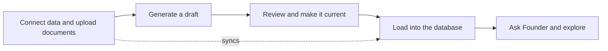

<Badge color="purple" size="sm">Concept</Badge>

What your company knows is split across the systems it runs on: the database, billing,
support, contracts and call notes. People spend their time hunting across them. Agents
draft answers they can't finish. And revenue slips between the tools: a renewal at risk
shows only when you read the invoice, the usage, the tickets and the last call together.

Foundry connects the systems you run into one ontology, so your people and agents make
better calls, move faster and catch the revenue that slips between tools, with every
answer cited to its source. It's open source, under Apache 2.0.

- **Connected.** One graph across your systems, with the same customer matched across
  them.
- **Cited.** Every answer traces to the row or quote it came from.
- **Yours.** Open source. Run it on your own computer with the AI provider you choose,
  or a local model.
- **Agent-ready.** Your agent sets it up with you through the
  [Helix MCP](/foundry/agents/helix-mcp).

Search finds what looks relevant. Foundry follows what's connected; see
[Why an ontology instead of RAG](/foundry/start-here/ontology-vs-rag).

## How it works

Helix Foundry turns the tools your company runs on into one connected graph. Connect
sources such as Stripe or your PostgreSQL database, send it your app's or agent's own
data, upload the documents your tables don't cover, let Foundry's agent draft an
ontology across them, then load it into a Helix database, ask it questions, and
explore it as a graph or as records. Connectors keep syncing on a schedule, and
ontologies refresh when their data changes.

Foundry runs at [foundry.helix-db.com](https://foundry.helix-db.com), and your agents
reach it through the [Helix MCP](/foundry/agents/helix-mcp). Sign in with the account
you use for Helix Cloud; your workspaces come with it. To run it on your own computer
instead, start it from its
[repository](https://github.com/helixdb/helix-foundry) with Docker Compose.

<Frame caption="The whole path in two minutes: synced data, a generated draft, a load, the Explorer and a first answer.">
  <video controls muted playsInline preload="none" poster="https://assets.helix-db.com/docs/foundry/start-here/tour-poster.png" className="w-full" src="https://assets.helix-db.com/docs/foundry/start-here/tour.webm"></video>
</Frame>

## How it fits together

| Concept | What it is |
| --- | --- |
| **Workspace** | Your team's space, shared with Helix Cloud. It holds connections, documents, ontologies, members and the Foundry plan. |
| **Connection** | A source Foundry reads, with its credential. Each **sync** copies its tables into a snapshot Foundry keeps, on the plan's schedule or when you ask. |
| **API source** | A source your apps and agents send pieces of data to, over HTTP or the Helix MCP. |
| **Document** | A file of the workspace, such as a contract, kept in Connectors. A load reads text and PDFs for the names and facts they hold, and table files such as CSV as tables. |
| **Document set** | A folder of documents. A version reads the sets its generation picked. |
| **Ontology** | The types, links and rules that describe your data, bound to one Helix database. |
| **Generation** | A request to Foundry's agent to draft a new version of the ontology from the tables, API sources and document sets you pick. |
| **Version** | One draft of the ontology. Versions never change; you choose which one is current. |
| **Load** | One write of the current version into the ontology's database: your tables, then the documents of its sets. A **refresh**, which Foundry starts itself when the data changes, brings the current load up to date. What a load couldn't decide waits on the ontology's [Review](/foundry/ontologies/review) page. |
| **Founder** | Foundry's assistant, in private chats. It answers from your ontologies' loads through the Analyst and prepares changes you confirm. Foundry opens on it, and ⌘J (Ctrl J on Windows and Linux) opens it beside any other page. See [Founder](/foundry/ask/founder). |
| **Analyst** | The engine Founder asks: [questions](/foundry/ask/ask-questions) about a load in plain language, answered with the sources they came from. |
| **Explorer** | The graph and records view of a load, read from the database with your session. |
| **Dashboard** | Tiles of saved queries over your ontologies' loads, drawn as charts or tables. See [Dashboards](/foundry/automate/dashboards). |
| **Workflow** | Steps Foundry runs for you on a schedule, by hand, or when a sync, load, upload or draft finishes. Nothing runs until you approve it. See [Workflows](/foundry/automate/workflows). |

The work flows in one direction:

You can do each step on the website, or have your agent do it through the
[Helix MCP](/foundry/agents/helix-mcp), with your confirmation for every change.

## What Foundry does not do

- It never writes to your sources. Connections only read, and database users need
  `SELECT` only.
- It never deletes a Helix database. Deleting an ontology removes what its loads wrote
  and leaves the database's other data in place.
- It does not manage roles, member removal or single sign-on. Those stay in the
  [Helix dashboard](https://helix-db.com/login).

## How Foundry uses AI models

A generation sends your synced tables, and up to five of the newest documents of each
set it picks, to Foundry's agent, which drafts the version. A load sends your
documents' text to AI models, which find the names and facts they hold and check them.
Reading tables into a load uses no models. The Analyst sends your question, and what
each step reads from the load, to AI models. Founder sends your messages, and what its
tools read, to AI models, and so does each Founder step of a workflow. Assessing your
agents' [use case runs](/foundry/agents/helix-mcp#use-cases) sends each run's request,
calls and answer to AI models too.

By default these run on hosted providers through Helix, today Anthropic's Claude models.
On Pro or Max, an owner can run them on the workspace's own Anthropic key instead; see
[AI models](/foundry/workspace/ai-models). What loads, questions and use case run
assessments cost counts against the workspace's [monthly caps](/foundry/workspace/usage).
Founder's turns and workflows' Founder steps have monthly budgets of their own, and each
generation attempt has a spending cap of its own.

## Next steps

<CardGroup cols={2}>
  <Card title="Quickstart" icon="rocket" href="/foundry/start-here/quickstart">
    Go from sign-in to a first answer on your own data.
  </Card>
  <Card title="Try the sample company" icon="flask" href="/foundry/start-here/sample-company">
    See every step on a made-up company's data first.
  </Card>
  <Card title="Connect data" icon="plug" href="/foundry/data/connect-data">
    Add a source, test it and sync its tables.
  </Card>
  <Card title="Generate an ontology" icon="wand-magic-sparkles" href="/foundry/ontologies/generate-and-version">
    Draft types, links and mappings from your tables.
  </Card>
  <Card title="Ask Founder" icon="comments" href="/foundry/ask/founder">
    Ask your data questions in plain language, and confirm the changes it prepares.
  </Card>
  <Card title="Build a dashboard" icon="chart-line" href="/foundry/automate/dashboards">
    Keep answers as charts and tables your team can open.
  </Card>
  <Card title="Use Foundry from your agent" icon="robot" href="/foundry/agents/helix-mcp">
    Connect Claude Code, Codex or another agent through the Helix MCP.
  </Card>
  <Card title="Send data from your app" icon="code" href="/foundry/data/api-sources">
    Push pieces of data to an API source.
  </Card>
  <Card title="Run a pilot" icon="flag-checkered" href="/foundry/use-cases/run-a-pilot">
    Answer five business questions on your own data.
  </Card>
</CardGroup>
