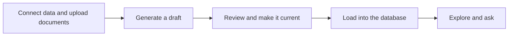

<Badge color="purple" size="sm">Concept</Badge>

Helix Foundry turns the tools your company runs on into one connected graph. Connect
sources such as Stripe or your PostgreSQL database, upload the documents your tables
don't cover, let Foundry's agent draft an ontology across them, then load it into a
Helix database, explore it as a graph or as records, and ask it questions.

Foundry runs at [foundry.helix-db.com](https://foundry.helix-db.com). Sign in with the
account you use for Helix Cloud; your workspaces come with it.

<Frame caption="The whole path in two minutes: synced data, a generated draft, a load, the Explorer and Ask.">
  <video controls muted playsInline preload="none" poster="https://assets.helix-db.com/docs/foundry/start-here/tour-poster.png" className="w-full" src="https://assets.helix-db.com/docs/foundry/start-here/tour.webm"></video>
</Frame>

## How it fits together

| Concept | What it is |
| --- | --- |
| **Workspace** | Your team's space, shared with Helix Cloud. It holds connections, documents, ontologies, members and the Foundry plan. |
| **Connection** | A source Foundry reads, with its credential. Each **sync** copies its tables into a snapshot Foundry keeps. |
| **Document** | A file of the workspace, such as a contract, kept in Data. A load reads Markdown and text documents for the names and facts they hold; other formats, such as CSV, JSON or PDF, are kept to view. |
| **Document set** | A folder of documents in Data. A version reads the sets its generation picked. |
| **Ontology** | The types, links and rules that describe your data, bound to one Helix database. |
| **Generation** | A request to Foundry's agent to draft a new version of the ontology from your synced tables and the document sets you pick. |
| **Version** | One draft of the ontology. Versions never change; you choose which one is current. |
| **Load** | One write of the current version into the ontology's database: your tables, then the documents of its sets. |
| **Explorer** | The graph and records view of a load, read from the database with your session. |
| **Ask** | Questions about a load in plain language, answered with the sources they came from. |

The work flows in one direction:

## What Foundry does not do

- It never writes to your sources. Connections only read, and database users need
  `SELECT` only.
- It never deletes a Helix database. Deleting an ontology removes what its loads wrote
  and leaves the database's other data in place.
- It does not manage roles, member removal or single sign-on. Those stay in the
  [Helix dashboard](https://helix-db.com/login).

## How Foundry uses AI models

A generation sends your synced tables, and up to five of the newest documents of each
set it picks, to Foundry's agent, which drafts the version. A load sends your
documents' text to Anthropic and OpenAI models, which find the names and facts they
hold and check them. Reading tables into a load uses no models. Ask sends your question,
and what each step reads from the load, to Anthropic models.

## Next steps

<CardGroup cols={2}>
  <Card title="Quickstart" icon="rocket" href="/foundry/start-here/quickstart">
    Go from sign-in to an explored graph in about ten minutes.
  </Card>
  <Card title="Connect data" icon="plug" href="/foundry/data/connect-data">
    Add a source, test it and sync its tables.
  </Card>
  <Card title="Generate an ontology" icon="wand-magic-sparkles" href="/foundry/ontologies/generate-and-version">
    Draft types, links and mappings from your tables.
  </Card>
  <Card title="Ask questions" icon="comments" href="/foundry/ask/ask-questions">
    Ask your data questions in plain language.
  </Card>
</CardGroup>
