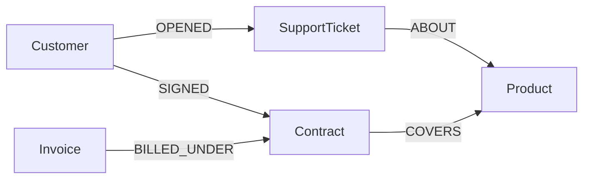

<Badge color="purple" size="sm">Concept</Badge>

An ontology is a shared definition of the kinds of things a domain contains, how they
connect, and the rules they follow. Think of it as the legend on a map: it says what
each symbol means, so everyone reading the map reads it the same way. In data work, an
ontology names types such as `Customer`, `Contract`, and `Invoice`, the links allowed
between them, and the rules the data must pass, so records from many systems land in
one consistent [knowledge graph](/learn/graph-databases/what-is-a-knowledge-graph).

  <Card title="Learning objectives" icon="graduation-cap">
    After reading this article you will be able to:

    - Name the parts of an ontology: types, properties, links, identifiers, and rules
    - Explain how an ontology differs from a database schema
    - Describe why an ontology helps when data lives in many systems
    - Outline how to build and version an ontology over real data
  </Card>

## What is in an ontology?

An ontology lists types of things, the properties each type has, the links between
types, how to tell two records of a type apart, and rules the data should follow.

| Part | What it is | Example |
| --- | --- | --- |
| Type | A kind of thing the domain contains | `Customer`, `Contract`, `SupportTicket` |
| Property | A typed value every record of a type can carry | A contract's `startDate`, a customer's `plan` |
| Link | A named, directed connection between two types | A `Contract` is `SIGNED_BY` a `Customer` |
| Identifier | The values that pick out one record of a type | A customer's account ID or email domain |
| Rule or constraint | A condition the data must pass, or a fact derived from others | "Every invoice belongs to exactly one customer" |

For example, a software company's ontology might connect customers, the contracts they
sign, the invoices billed against those contracts, and the tickets they open:

The ontology describes shapes, not instances. `Customer` is in the ontology; a
particular customer is a record in the graph that follows it. Stored in a
[graph database](/learn/graph-databases/what-is-a-graph-database), types usually become
node labels and links become edge labels, as in a
[property graph](/learn/graph-databases/what-is-a-property-graph).

## What is the difference between an ontology and a schema?

A schema says how data is stored; an ontology says what the data means. A schema is
like a filing cabinet's drawer labels, and an ontology is the company glossary that
explains what each label refers to and how the files relate.

| | Database schema | Ontology |
| --- | --- | --- |
| Main concern | Tables, columns, types, and keys for one system | Concepts, their links, and their meaning across systems |
| Scope | Usually one database | A whole domain, spanning many sources |
| Relationships | Foreign keys, often unnamed | Named, directed links such as `SIGNED_BY` |
| Rules | Storage constraints such as `NOT NULL` | Business rules, and sometimes facts derived from other facts |
| Hierarchies | Rare | Common: a `Laptop` is a kind of `Product` |

The two are complementary. A mapping connects them: it says which table and columns
fill each type and link, so the same `Customer` can be filled from a billing system and
a CRM at once. Formal ontology languages, such as OWL in the RDF world, add precise
semantics and automated inference; see
[property graph vs RDF](/learn/graph-databases/property-graph-vs-rdf). Application
ontologies over a property graph tend to be lighter: types, links, identifiers, and
rules the data is checked against.

  <Card title="Try Helix Foundry" icon="rocket" href="/foundry/start-here/quickstart" cta="Get started">
    Connect your company's data, let an agent draft an ontology over it, and load it into HelixDB as one graph.
  </Card>

## Why does a business need an ontology?

Because the same thing is described differently in every system. Billing calls it an
account, the CRM calls it a company, and a contract PDF calls it "the Client". An
ontology gives them one name and one shape, so a question about customers means the
same thing whichever system the answer comes from.

That pays off in three places:

- **Questions across systems.** "Which customers with open support tickets have a
  contract renewing this quarter?" needs tickets, contracts, and customers joined by
  meaning, not by whichever IDs each system happens to use.
- **AI grounding.** A language model answers better from typed, connected facts than
  from loose text. Retrieval that follows links, often called
  [GraphRAG](/learn/ai-memory/what-is-graphrag), needs an ontology to know which links
  exist. It also gives [retrieval-augmented generation (RAG)](/learn/ai-memory/what-is-rag)
  and [agent memory](/learn/ai-memory/what-is-ai-agent-memory) a fixed shape to store
  facts in.
- **Trust.** Rules catch records that break expectations, and identifiers decide when
  two records are the same thing, the job of
  [entity resolution](/learn/ontologies/what-is-entity-resolution). Each fact can
  carry its source, its [provenance](/learn/ontologies/what-is-data-provenance), so a
  person can check it.

## How do you build an ontology?

Start from the questions you want answered, look at the data you already have, draft
the smallest set of types and links that answers them, then test the draft against the
data and revise.

<Steps>
  <Step title="Write down the questions">
    List the questions the ontology must answer, in plain words. They decide which
    types and links earn a place; anything no question needs can wait.
  </Step>
  <Step title="Survey the sources">
    Inventory the tables, apps, and documents that hold the answers. Structured tables
    map onto types almost directly. Documents such as contracts or call notes hold
    facts that need extraction.
  </Step>
  <Step title="Draft types, links, and identifiers">
    Name each type and link, list each type's properties, and choose identifiers that
    pick out one record. An LLM can draft this from samples of your data and your
    questions, but a person should read the draft.
  </Step>
  <Step title="Map the sources">
    Say which table and columns fill each type and link, and which documents may fill
    which types. Mappings let the ontology stay stable while sources change.
  </Step>
  <Step title="Add rules">
    Add constraints the data should pass, such as cardinality ("one customer per
    contract"), and rules that derive new facts from existing ones.
  </Step>
  <Step title="Load, check, and revise">
    Load real data, look at what breaks the rules or fails to link, and revise. Keep
    each revision as a new version rather than editing in place.
  </Step>
</Steps>

## How do you change an ontology over time?

Treat it like code: make each change a new, immutable version, review it, choose which
version is current, and roll back by making an older one current.

- **Version, don't edit.** A version that never changes can be compared, cited, and
  restored. Loads record which version they followed.
- **Reload after a change.** A new type or link only holds data once the sources are
  loaded through it again. Keeping the previous load alongside the new one lets you
  compare them before switching.
- **Grow with the questions.** When a new question needs a link the ontology lacks, add
  the link in a new version instead of forcing the data into an existing one.

## How does Helix Foundry build an ontology?

[Helix Foundry](/foundry/start-here/introduction) drafts and versions ontologies over a
company's data and loads them into a HelixDB database:

- **An agent drafts each version.** A
  [generation](/foundry/ontologies/generate-and-version) reads the synced tables, API
  sources, and document sets you choose, plus the questions you write, and drafts types,
  links, mappings, document routes, rules, and the questions the version should answer.
  The agent may stop to ask what only you can answer.
- **Versions never change.** Each draft is stored beside the others, with tabs for its
  types (with their keys and identifiers), links, mappings, sources, rules, and its
  `ontology.toml` and `mappings.toml`. Edits to routes, identifiers, rules, and
  constraints make a new version. You choose the current version and roll back by
  making an older one current.
- **Loads follow the current version.** A [load](/foundry/ontologies/load-data) writes
  the current version's tables and documents into the ontology's HelixDB database, and
  lists the records that break its constraints. Rules can derive facts that an entity's
  page shows, worked out when read and never stored.

Start with the [Foundry quickstart](/foundry/start-here/quickstart) or the
[sample company](/foundry/start-here/sample-company).

## Frequently asked questions

### Is an ontology the same as a knowledge graph?

No. The ontology defines the types, links, and rules; the
[knowledge graph](/learn/graph-databases/what-is-a-knowledge-graph) is the data that
follows them. One ontology can describe many graphs, such as a test load and a
production load.

### Do you need OWL or RDF to have an ontology?

No. OWL and RDF are standards suited to publishing and reasoning over shared
vocabularies. An application ontology over a
[property graph](/learn/graph-databases/what-is-a-property-graph) works well when the
goal is querying and grounding AI on your own data.

### Can an LLM write an ontology?

An LLM can draft one quickly from data samples and your questions, and it is good at
naming types and spotting links. It can also invent links the data does not support or
miss a rule only your team knows, so review each draft and test it against real data.

### How big should an ontology be?

As small as the questions allow. A few dozen types answer most business questions; a
large ontology nobody loads data into is harder to maintain than a small one that is
used every day.

## Related topics

<CardGroup cols={2}>
  <Card title="What is a knowledge graph?" icon="circle-nodes" href="/learn/graph-databases/what-is-a-knowledge-graph">
    The connected facts an ontology organizes.
  </Card>
  <Card title="What is entity resolution?" icon="object-group" href="/learn/ontologies/what-is-entity-resolution">
    Deciding when records and mentions refer to the same thing.
  </Card>
  <Card title="What is data provenance?" icon="fingerprint" href="/learn/ontologies/what-is-data-provenance">
    Recording where every value came from, so answers can be checked.
  </Card>
  <Card title="What is a property graph?" icon="tags" href="/learn/graph-databases/what-is-a-property-graph">
    Labeled nodes and edges with typed properties on both.
  </Card>
  <Card title="Property graph vs RDF" icon="code-compare" href="/learn/graph-databases/property-graph-vs-rdf">
    Two ways to model a knowledge graph, compared side by side.
  </Card>
  <Card title="What is GraphRAG?" icon="share-nodes" href="/learn/ai-memory/what-is-graphrag">
    Retrieval that follows relationships, compared with vector RAG.
  </Card>
</CardGroup>
