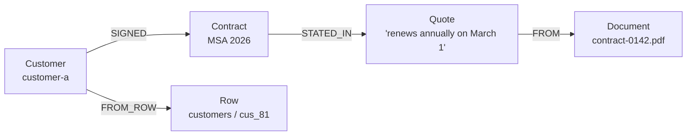

<Badge color="purple" size="sm">Concept</Badge>

Data provenance is the record of where a piece of data came from and how it got there.
Think of it as a footnote on every fact: a customer's renewal date points to the table
row that holds it, and a contract term points to the sentence in the PDF that states
it. With provenance, a person or an AI answer can cite each claim, a wrong value can be
traced to its source, and deleting a source tells you exactly which facts to remove.

  <Card title="Learning objectives" icon="graduation-cap">
    After reading this article you will be able to:

    - Describe what a provenance record holds, from source to method
    - Explain how provenance differs from data lineage
    - Describe how to model provenance in a graph
    - Explain how provenance makes AI answers checkable
  </Card>

## What does provenance record?

A provenance record says which source a value came from, where in that source, when it
was read, and how it was produced. For values pulled out of text, it also records how
confident the extraction was.

| Field | What it says | Example |
| --- | --- | --- |
| Source | The system or file the value came from | The billing database, `contract-0142.pdf` |
| Location | Where in the source | Row `cus_81` of the `customers` table, page 3 of the PDF |
| Evidence | The exact text or value read | "The term renews annually on March 1" |
| Time | When it was read, and when the source said it | Synced on May 2; document dated April 28 |
| Method | How it was produced | Copied from a column, extracted by an LLM, derived by a rule |
| Confidence | How sure the method was | A verifier's score of 0.92 |

Provenance can attach at different grains: a whole record, one property, or one
relationship. Property-level provenance matters most when one entity is filled from
several sources, for example a customer whose name comes from the CRM and whose plan
comes from billing.

## What is the difference between data provenance and data lineage?

Provenance is about one value: where did this fact come from? Lineage is about the
pipeline: which jobs and tables does data flow through on its way to this report?
Provenance is the receipt for one purchase; lineage is the supply chain.

| | Data provenance | Data lineage |
| --- | --- | --- |
| Question | Where did this value come from? | How does data move between systems? |
| Grain | A record, a value, or a single fact | Datasets, tables, columns, and jobs |
| Typical use | Citations, audits, corrections, deletion | Impact analysis, debugging pipelines |
| Stored | Next to the data, often per fact | In a catalog or pipeline metadata |

Many teams use both. Lineage tells you a dashboard depends on the billing table;
provenance tells you which row in that table produced the number you are looking at.

  <Card title="Try Helix Foundry" icon="rocket" href="/foundry/start-here/quickstart" cta="Get started">
    Load your company's data into HelixDB with every value linked to the row or quote it came from.
  </Card>

## Why does provenance matter for AI answers?

Because an answer you cannot check is hard to trust. When each fact carries its source,
an AI application can cite the row or quote behind every claim, and a person can open
it and see whether the claim holds.

[Retrieval-augmented generation (RAG)](/learn/ai-memory/what-is-rag) already cites the
passages it retrieved. A [knowledge graph](/learn/graph-databases/what-is-a-knowledge-graph)
with provenance goes further: an answer assembled from several connected facts, as in
[GraphRAG](/learn/ai-memory/what-is-graphrag), can cite each fact separately.
Provenance also helps when facts are wrong:

- **Debugging.** A bad answer traces back to the fact it used, and that fact traces back
  to a source row or an extraction that misread a sentence.
- **Confidence.** Facts an LLM extracted can carry a score, so low-confidence facts can
  be held for a person instead of shown as settled.
- **Deletion and freshness.** When a document is removed or replaced, provenance names
  every fact it produced, which is how
  [long-term agent memory](/learn/ai-memory/long-term-memory-for-ai-agents) honors a
  deletion request.

## How do you model provenance in a graph?

Store each source as a node and connect facts to it, or store the source details as
properties on the relationship the fact describes. A
[property graph](/learn/graph-databases/what-is-a-property-graph) suits both because
nodes and edges carry their own properties.

Two common patterns:

- **Source nodes.** Documents, chunks, quotes, and table rows become nodes, and facts
  link to them with edges such as `STATED_IN` or `FROM_ROW`. This suits facts many
  sources support, and makes "what came from this document?" a one-hop query.
- **Edge properties.** A relationship carries `source`, `extractedAt`, and
  `confidence` as properties. This keeps the graph smaller when each fact has one
  source.

Either way, index the fields you filter on, such as the source ID or extraction time, so
retracting a source or showing only recent facts stays fast.

## What happens when sources disagree?

Pick a rule, apply it the same way every time, and keep both claims' provenance. A
common rule is to trust a system of record, such as the billing table, over text, and
to let a newer dated document win over an older one. Values that no rule settles go to
a person.

Disagreement is often a symptom of an [entity resolution](/learn/ontologies/what-is-entity-resolution)
problem: two records were merged that should not have been. Keeping provenance per
value lets you see which source said what before deciding, and the
[ontology](/learn/ontologies/what-is-an-ontology) can mark which properties may hold
only one value.

## How does Helix Foundry record provenance?

[Helix Foundry](/foundry/start-here/introduction) keeps where every value came from
when it loads a company's data into HelixDB:

- **Rows and quotes.** In the Explorer's
  [records view](/foundry/explore/records-and-entities), a record or link that came
  from a table names its source and row; one that came from a document shows the quote,
  linked to its place in the document. An entity's page shows each property with the
  row or quote that states it.
- **Cited answers.** [Questions](/foundry/ask/ask-questions) about a load are answered
  with numbered citations to each record, table row, document quote, and rule used.
- **Held claims and disagreements.** A link a document states but the load was not sure
  of is held with its verifier score, and values documents state differently wait on
  the [Review](/foundry/ontologies/review) page. When a table and documents disagree,
  the table's value is kept unless a person chooses the document's.
- **Removed sources.** When a connection's document is removed at the source, Foundry
  takes it out of the current load.

## Frequently asked questions

### Is provenance the same as metadata?

Provenance is one kind of metadata. Metadata describes data in general, such as its
type, owner, or size; provenance specifically records origin and how the data was
produced.

### Does provenance make a graph much bigger?

It adds nodes or properties, often one source link per fact. Storing sources once and
linking to them, rather than copying text into every fact, keeps the overhead modest,
and the ability to cite and retract usually outweighs it.

### Can you add provenance after loading data?

Only partly. The source, location, and method are easiest to capture at load time; once
values from several sources are merged without it, the link back is lost. Record
provenance as data is written.

### How does provenance help with compliance?

It answers "where did this come from?" and "what did this source produce?" directly.
That supports audits and requests to correct or delete data tied to one source.

## Related topics

<CardGroup cols={2}>
  <Card title="What is an ontology?" icon="sitemap" href="/learn/ontologies/what-is-an-ontology">
    Shared types, links, and rules for data from many systems.
  </Card>
  <Card title="What is entity resolution?" icon="object-group" href="/learn/ontologies/what-is-entity-resolution">
    Deciding when records and mentions refer to the same thing.
  </Card>
  <Card title="What is a knowledge graph?" icon="circle-nodes" href="/learn/graph-databases/what-is-a-knowledge-graph">
    Connected facts organized by an ontology, with their sources.
  </Card>
  <Card title="What is RAG?" icon="book-open" href="/learn/ai-memory/what-is-rag">
    Grounding a model's answer in data retrieved at query time.
  </Card>
  <Card title="What is GraphRAG?" icon="share-nodes" href="/learn/ai-memory/what-is-graphrag">
    Retrieval that follows relationships, compared with vector RAG.
  </Card>
  <Card title="Long-term memory for AI agents" icon="memory" href="/learn/ai-memory/long-term-memory-for-ai-agents">
    Storing, updating, and deleting what an agent remembers.
  </Card>
</CardGroup>
